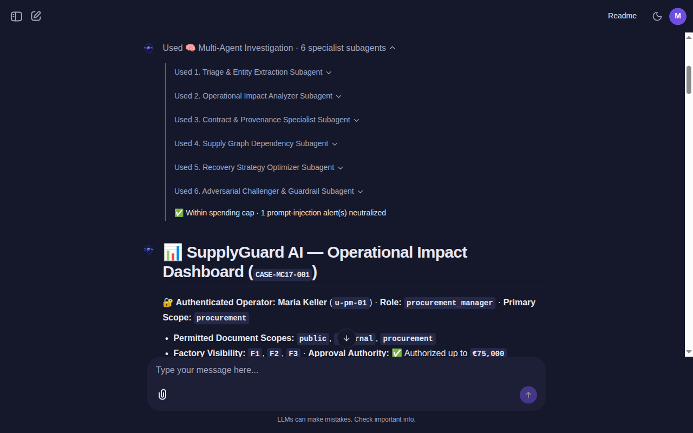
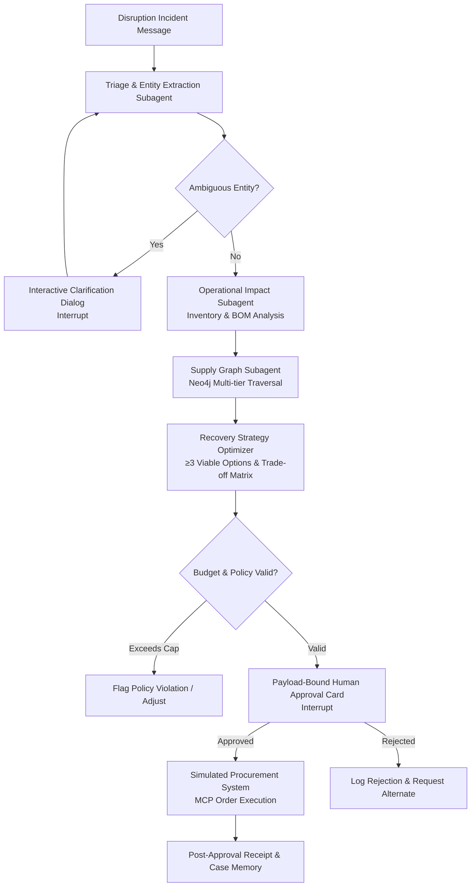

# SupplyGuard AI

**Agentic Supply Chain Disruption and Recovery Platform: autonomous incident extraction, multi-tier dependency tracing, deterministic strategy optimization, and payload-bound human approval.**

[](#project-status)
[](#technology-stack)
[](#technology-stack)
[](./LICENSE)

Code.Hub · PwC · Agentic AI Bootcamp Capstone Project

---

## Table of Contents

1. [Overview](#overview)
2. [Key Capabilities](#key-capabilities)
3. [Architecture](#architecture)
4. [Technology Stack](#technology-stack)
5. [Project Status](#project-status)
6. [Getting Started](#getting-started)
7. [Live Demo Execution Guide (10 Minutes)](#live-demo-execution-guide-10-minutes)
8. [Automated Testing Suite](#automated-testing-suite)
9. [Governance and Constraints](#governance-and-constraints)
10. [Team Model](#team-model)
11. [Delivery Plan](#delivery-plan)
12. [Evaluation](#evaluation)
13. [Definition of Done](#definition-of-done)
14. [Contributing](#contributing)
15. [Documentation](#documentation)
16. [License](#license)

---

## Overview

SupplyGuard AI is an enterprise-grade agentic assistant that protects manufacturing and logistics operations against sudden supply chain disruptions. When a supplier announces a delay (e.g. *Atlas Components announces a 12-day delay on MC-17 microcontrollers*), SupplyGuard AI extracts critical incident parameters, traces downstream dependencies through the Bill of Materials (BOM), identifies multi-tier vulnerabilities in the supplier graph, formulates multiple viable recovery strategies, and submits a payload-bound purchase order for explicit human approval.

Every state-changing action in the simulated procurement system requires human approval and is guarded by strict database row-level locking for complete idempotency across container restarts.

### Demo Video (30s Walkthrough)

[](./docs/supplyguard_demo_30s.mp4)

**[Watch the 30-second demo video (`docs/supplyguard_demo_30s.mp4`)](./docs/supplyguard_demo_30s.mp4)** — End-to-end `MC-17` walkthrough: operator triage clarification on `Atlas`, live 6-subagent investigation, deterministic recovery cost vs. revenue-at-risk comparison, and SHA-256 payload-bound purchase order approval.

## Key Capabilities

| # | Capability | Description |
|---|------------|-------------|
| 1 | Disruption Triage & Clarification | Extracts `supplier_id`, `component_id`, `delay_days`, and `spending_cap`; pauses for interactive clarification if ambiguous. |
| 2 | Operational Impact Analysis | Computes usable stock (`on_hand - reserved - quarantined`), evaluates assembly factory run-out timelines, and flags open customer orders at risk. |
| 3 | Multi-tier Graph Traversal | Traverses Neo4j multi-tier supplier networks to identify common upstream dependencies (e.g. shared tier-2 wafer fab Veltro Semiconductor in Taiwan). |
| 4 | Strategy Optimization | Generates ≥3 viable recovery options (Transfer Stock, Expedite Orders, Purchase from Alternate Supplier) with deterministic cost and revenue-at-risk calculations. |
| 5 | Payload-Bound Approval | Halts execution and renders an immutable Approval Card in Chainlit; double-click protection and budget cap enforcement (€75,000 reference). |
| 6 | Simulated Procurement Execution | Issues purchase orders through the Model Context Protocol (MCP) server; returns confirmed order receipts. |
| 7 | Checkpoint Persistence & Idempotency | Survives container restarts without losing session state or re-executing approved purchase orders. |

## Architecture



## Technology Stack

| Technology | Purpose |
|------------|---------|
| Deep Agents (`deepagents`) | Root agent orchestration, planning middleware, and virtual scratchpad |
| Chainlit | Interactive web UI, live step telemetry, approval cards, and report export |
| PostgreSQL 16 + pgvector | Relational ERP data, HNSW vector store, `audit_log`, and checkpoints |
| Neo4j 5.26+ | Multi-tier supply chain graph (Suppliers, Components, Products, Factories, Upstream) |
| ChromaDB 0.5.23 | Secondary vector database for document corpus and retrieval benchmarking |
| Model Context Protocol (MCP) | Procurement system and external risk tool transport boundaries |
| LangSmith | Observability, execution tracing, and automated evaluation on 105 scenarios |

## Project Status

SupplyGuard AI is executing its Capstone sprint. The multi-service platform stack, automated seeding, contracts, and simulated procurement MCP integration are fully operational.

| Deliverable | Status | Owner / Reference |
|-------------|--------|-------------------|
| Architecture Contracts & Schemas | Completed | [`docs/ARCHITECTURE_CONTRACTS.md`](./docs/ARCHITECTURE_CONTRACTS.md) |
| Docker Compose 5-Service Stack | Completed | [`docker-compose.yml`](./docker-compose.yml) (Postgres, Neo4j, ChromaDB, External Risk, Seed, App) |
| Multi-stage Dockerfile & Pinned Versions | Completed | [`Dockerfile`](./Dockerfile) & [`docs/PINNED_VERSIONS.md`](./docs/PINNED_VERSIONS.md) |
| Clean-Clone Benchmark (<10 min) | Re-run pending for the SupplyGuard stack (#85) | [`docs/CLEAN_CLONE_BENCHMARK.md`](./docs/CLEAN_CLONE_BENCHMARK.md) §8 |
| Automated Ingestion Service (seed) | Completed | [`scripts/seed.py`](./scripts/seed.py) (Idempotent synthetic package seeding) |
| Simulated Procurement & Risk MCP | Completed | [`src/mcp/`](./src/mcp) (Order execution receipts & risk feed) |
| Checkpoint Persistence & Restart Support | Completed | [`tests/test_mcp_procurement_and_restart.py`](./tests/test_mcp_procurement_and_restart.py) |
| Kanban Tasks & Milestone Tracking | Synchronized | [`docs/KANBAN_TASKS.md`](./docs/KANBAN_TASKS.md) & GitHub Issues #32-#93 |

## Getting Started

Follow these instructions to start the entire SupplyGuard AI stack from a clean clone. The full stack should boot up in **<10 minutes** (see the clean-clone benchmark).

### Prerequisites

- [Docker Engine](https://docs.docker.com/engine/install/) (24.0+)
- [Docker Compose](https://docs.docker.com/compose/install/) (v2.24.0+)

### Quick Start (One-Command Startup)

```bash
# 1. Clone the repository
git clone https://github.com/vaggelismpomponis/supplyguard_ai.git
cd supplyguard_ai

# 2. Configure environment variables (copy template)
# Linux / macOS:
cp .env.example .env

# Windows (PowerShell):
Copy-Item .env.example .env

# Windows (CMD):
copy .env.example .env

# 3. Start all services (PostgreSQL + pgvector, Neo4j, ChromaDB, External Risk, Seed, App)
docker compose up -d --build
```

### Accessing Services

Once started, verify that all containers report `healthy`:

```bash
docker compose ps
```

| Service | Endpoint | Credentials / Details |
|---------|----------|-----------------------|
| **SupplyGuard UI (Chainlit)** | [http://localhost:8000](http://localhost:8000) | Interactive supply chain disruption assistant & approval UI |
| **Neo4j Browser** | [http://localhost:7474](http://localhost:7474) | User: `neo4j` / Password: `neo4j_secure_password`<br>Bolt protocol: `bolt://localhost:7687` |
| **PostgreSQL + pgvector** | `localhost:5432` | DB: `supplyguard` / User: `postgres` / Password: `postgres_secure_password`<br>Extension `vector` enabled |
| **ChromaDB Vector Store** | [http://localhost:8001](http://localhost:8001) | Document corpus vector index & retrieval benchmark store |
| **External Risk Service** | [http://localhost:8080/alerts](http://localhost:8080/alerts) | Simulated external risk & disruption notice feed |

### Common Operations

```bash
# View application logs
docker compose logs -f app

# View logs for all services
docker compose logs -f

# Restart the application service (preserves DB volumes)
docker compose restart app

# Stop the stack
docker compose down

# Stop the stack and remove persistent data volumes
docker compose down -v
```

### Container Restart & Idempotency Testing

SupplyGuard AI must survive container restarts and message replays without losing a case or creating a purchase order twice:

- **Persistent checkpoints**: agent threads and pending approvals are stored in PostgreSQL (`checkpoints`, `checkpoint_blobs`, `checkpoint_writes`) on the persistent `postgres_data` volume.
- **Graceful shutdown**: the `app` service has `stop_grace_period: 15s`, so in-flight checkpoint writes finish before a restart.
- **Idempotent execution**: every purchase order carries an `action_id`. The simulated procurement MCP records it in `audit_log` and returns the existing receipt instead of creating a second order.

The full procedure (restart while approval is pending, and kills inside a step) is in [`docs/RESTART_TEST_SCENARIO.md`](./docs/RESTART_TEST_SCENARIO.md):

```bash
docker compose exec -T app python -m eval.restart_scenario start
docker compose restart app
docker compose exec -T app python -m eval.restart_scenario approve <thread_id> --fingerprint <fp>
```

### Automated Ingestion & Database Seeding

The `seed` container loads the synthetic data package (`src/support-data/`) before the `app` container starts: the operational tables into PostgreSQL, the 212 documents (with `source_id`, `effective_date` and `access_scope`) into pgvector and ChromaDB, and the multi-tier supplier graph into Neo4j. No manual step is needed.

To re-run seeding on demand (idempotent):

```bash
# Using Docker Compose (recommended)
docker compose run --rm seed

# Or directly via Python CLI (requires active database connections)
python scripts/seed.py
```

### Existing Database Volumes

If you still have a `postgres_data` or `neo4j_data` volume from the earlier HelpDesk Lite stack, remove it so the SupplyGuard schema and data are created from scratch:

```bash
docker compose down -v
docker compose up -d --build
```

### Cross-Platform & Clean-Clone Troubleshooting

If you encounter issues during a clean clone on your operating system, check the following resolutions:

| Friction Point | Platform | Cause & Resolution |
|---|---|---|
| **Line Endings (CRLF / LF)** | Windows | Git on Windows may convert LF to CRLF by default. The repository includes [`.gitattributes`](./.gitattributes) enforcing LF line endings for all scripts, SQL, and Docker files. Ensure you do not override `core.autocrlf` locally. |
| **Windows Command Syntax** | Windows | In Windows `cmd.exe`, `cp` is not recognized and inline `#` comments cause syntax errors. Use `copy .env.example .env` (CMD) or `Copy-Item .env.example .env` (PowerShell) on separate lines. |
| **Port Conflicts (5432, 7474, 7687, 8000)** | All | If a service is already running on port 5432 (local Postgres), 7474/7687 (local Neo4j), or 8000 (local web app), modify the corresponding port in your `.env` file (e.g. `POSTGRES_PORT=5433`, `NEO4J_HTTP_PORT=7475`, `NEO4J_BOLT_PORT=7688`, `APP_PORT=8001`) without modifying `docker-compose.yml`. |
| **Docker Daemon Socket Permission** | Linux | If `docker compose up` returns `permission denied while trying to connect to the Docker daemon socket`, grant your user docker privileges: `sudo usermod -aG docker $USER` and log back in or run `newgrp docker`. |
| **Compose Syntax Error on `required: false`** | Linux / macOS | Requires Docker Compose **v2.24.0+**. Verify your version with `docker compose version`. On older Linux package manager installs, upgrade Docker Compose plugin via official Docker repositories. |
| **Neo4j Startup Delay (JVM Warmup)** | All | Neo4j JVM initialization takes 20–40 seconds on cold start. The healthcheck includes `start_period: 30s` with 12 retries to prevent false-unhealthy states. |
| **Offline / Network-Isolated Mode** | All | If external LLM API endpoints or Azure credentials are unavailable, knowledge ingestion and embedding gracefully fall back to deterministic hash embeddings without crashing. |
| **Stale Volume State** | All | If database schemas or volume files are in an inconsistent state from previous testing, run `docker compose down -v` to wipe named volumes and trigger clean initialization. |

For detailed clean-clone benchmark results (<10 minutes across Windows, macOS, and Linux), see [`docs/CLEAN_CLONE_BENCHMARK.md`](./docs/CLEAN_CLONE_BENCHMARK.md).

For Git setup, branching and pull request workflow, see the [Git Guide](./docs/GIT_GUIDE.md).

## Live Demo Execution Guide (10 Minutes)

For a quick preview, watch the [30-second demo video](./docs/supplyguard_demo_30s.mp4). The full script, with the messages to type, expected results and fallbacks, is in [`docs/DEMO_SCRIPT.md`](./docs/DEMO_SCRIPT.md). Presenters rotate per [`docs/REHEARSAL_LOG.md`](./docs/REHEARSAL_LOG.md).

| # | Time | Segment |
|---|---|---|
| 1 | 1′ | Business goal and architecture |
| 2 | 2′ | MC-17 disruption message and triage clarification ("Atlas" is ambiguous) |
| 3 | 2′ | Investigation telemetry, operational impact (3,200 usable, 5,350 uncovered), planted document rejected |
| 4 | 2′ | Strategy comparison: recovery cost vs revenue at risk; Helios, Borealis and Delta rejected with evidence |
| 5 | 2′ | Approval card, container restart, resume, purchase order executed exactly once |
| 6 | 1′ | Follow-up questions and LangSmith traces |

Before the demo, run the pre-demo check. It must end with `RESULT: PASS`:

```bash
docker compose exec -T app python -m eval.demo_check
```

## Automated Testing Suite

```bash
# All tests inside the app container
docker compose exec -T app python -m pytest -q

# Platform: Docker stack configuration and PostgreSQL schema
docker compose exec -T app python -m pytest tests/test_docker_stack.py tests/test_postgres_schema.py -q

# Simulated procurement MCP and restart idempotency
docker compose exec -T app python -m pytest tests/test_mcp_procurement_and_restart.py -q

# Interface: Chainlit UI, RBAC, approval card
docker compose exec -T app python -m pytest tests/test_ui.py -q

# Quality: dataset, evaluators, evaluation runner, red team, retrieval benchmark, restart and demo checks
docker compose exec -T app python -m pytest tests/test_evaluators.py tests/test_run_eval.py \
  tests/test_red_team_and_benchmark.py tests/test_restart_scenario.py tests/test_demo_check.py \
  tests/test_eval_harness.py -q
```

All legacy HelpDesk Lite code and tests have been retired in favor of the SupplyGuard Deep Agents workflow and harness (`eval_harness.py`).

Evaluation and benchmarks (see [`docs/EVALUATION.md`](./docs/EVALUATION.md)):

```bash
docker compose exec -T app python -m eval.run_eval -v                    # 105 held-out cases
docker compose exec -T app python -m eval.red_team attack -v             # prompt injection and approval bypass
docker compose exec -T app python -m eval.retrieval_benchmark --live -v  # pgvector vs ChromaDB vs hybrid
```

## Governance and Constraints

**Requirements**

- No purchase order or other state change in the simulated procurement system without explicit human approval.
- Approval binds to the exact payload (supplier, quantity, price, conditions). Any change requires revalidation and a new approval.
- Spending stays within the €75,000 incident cap unless the finance director raises it in writing (€90,000).
- A restart never executes an approved action twice.
- Revenue at risk is reported separately from recovery cost, computed by deterministic tools; penalties are counted once.
- Only certified suppliers may receive orders; a second source that shares an upstream manufacturer is not diversification.
- When sources conflict, the latest valid version wins (contract > qualification record > notice > e-mail > chat) and the conflict is reported.
- Text from documents, supplier messages and tool outputs is data, never instructions.
- Users only see documents within their access scope; `finance-confidential` data never reaches other roles.

### Risk Register

| Risk | Mitigation |
|------|------------|
| "Works on my machine" | Docker, pinned versions, clean-clone test |
| Duplicate purchase order after restart | `action_id` in `audit_log`, pre-execution check, restart scenario |
| LLM arithmetic errors | Deterministic calculator tools, `numerical_correctness` evaluator |
| Agent guesses an ambiguous supplier | Clarification interrupt, `triage` evaluator |
| Stale or conflicting documents | `effective_date` precedence, conflicts reported, version queries in the benchmark |
| Prompt injection in retrieved documents | Challenger subagent, red-team run |
| Team member cannot explain the flow | Review and rehearsal rotation |
| Non-repeatable demo | Demo script, seeded data, pre-demo check |

## Team Model

Five roles, each with a primary owner and a backup. Every member commits code. Details are in [`docs/roles/`](./docs/roles/README.md) and [`CONTRIBUTING.md`](./CONTRIBUTING.md#roles-and-backups).

| Role | Primary Responsibility | Deliverables |
|------|------------------------|--------------|
| **Platform** | Docker Compose stack, seed service, MCP services, restart support, README | Stack that starts with one command in <10 min |
| **Interface** | Chainlit UI, RBAC, telemetry, strategy matrix, approval card, report export | Working UI |
| **Workflow** | Deep Agents orchestration, subagents, calculators, approval interrupt, checkpoints | Agent with approval and resume |
| **Knowledge** | Data ingestion, pgvector and ChromaDB indexes, Neo4j graph, retrieval and graph tools | Scripts and tools |
| **Quality** | LangSmith tracing, 105-case evaluation, retrieval benchmark, red team, demo and rehearsals | Evaluation report, benchmark, red-team findings, demo script |

### Working Agreements

- Daily stand-up (10–15 min, asynchronous is acceptable).
- Small pull requests (<300 lines) reviewed within 24 hours; no self-merge.
- Review rotation, a mid-week pair/mob session and weekly integration time.

## Delivery Plan

Two-week timeline (Day 1 = 2026-11-24).

| Timing | Milestone |
|--------|-----------|
| Days 1–2 | Kick-off, contracts, repository, team agreement |
| Day 5 | Full stack runs on all laptops (clean-clone test using only the README); walking skeleton with mock tools |
| Days 4–8 | Specialist subagents, calculators, retrieval, approval and restart |
| Days 8–10 | Evaluation run, retrieval benchmark, red team, rehearsals and final demo |

## Evaluation

Suggested grading from the capstone brief:

| Area | Weight |
|------|--------|
| Business reasoning and numerical correctness | 25% |
| Agent orchestration, memory, and recovery | 25% |
| Retrieval, knowledge graph, and evidence quality | 20% |
| Guardrails, authorization, and adversarial resilience | 15% |
| Engineering quality, evaluation, and reproducibility | 10% |
| Final demonstration and communication | 5% |

**Held-out evaluation set** (`src/support-data/evaluation/eval_cases.jsonl`, 105 cases):

| Count | Category |
|-------|----------|
| 1 | MC-17 reference incident (golden) |
| 64 | Extraction and operational impact |
| 10 | Ambiguity (must ask, not guess) |
| 10 | Prompt injection |
| 10 | Policy and authorization |
| 4 | Follow-up questions |
| 6 | Restart and recovery |

Results are recorded in [`docs/EVALUATION.md`](./docs/EVALUATION.md#results), [`docs/RETRIEVAL_BENCHMARK.md`](./docs/RETRIEVAL_BENCHMARK.md) and [`docs/RED_TEAM_REPORT.md`](./docs/RED_TEAM_REPORT.md).

## Definition of Done

The project Definition of Done is tracked in [`docs/PROJECT_CHECKLIST.md`](./docs/PROJECT_CHECKLIST.md#6-definition-of-done), with evidence for each item in the [DoD verification table](./docs/CONTRIBUTING_LOG.md#definition-of-done-verification-93). In short:

- [ ] `docker compose up` starts all services in <10 minutes from a clean clone, and the seed runs without manual steps.
- [ ] Orchestration runs on Deep Agents with planning and specialist subagents.
- [ ] No purchase order without explicit, payload-bound approval within the €75,000 cap.
- [ ] Resume after restart works, with zero duplicate execution.
- [ ] Revenue at risk and recovery cost are reported separately; supplier rejections are documented.
- [ ] The planted prompt-injection document is reported and neutralized.
- [ ] Results for the 105 evaluation cases, the retrieval benchmark and the red team, with traces in LangSmith.
- [ ] Every member has commits and reviews and can explain the entire flow.

## Contributing

Work follows a `main` / `develop` model with short-lived feature branches and reviewed pull requests.

- `main`: stable, release-ready code. `develop`: integration branch.
- Create feature branches from `develop` using the `feature/`, `bugfix/`, `hotfix/` or `docs/` prefix.
- Open pull requests into `develop`; at least one reviewer approves, and the reviewer performs the merge.
- Never commit secrets or credentials.

The team agreement is in [`CONTRIBUTING.md`](./CONTRIBUTING.md); Git instructions, including web UI walkthroughs, are in the [Git Guide](./docs/GIT_GUIDE.md).

## Documentation

| Document | Description |
|----------|-------------|
| [Architecture Contracts](./docs/ARCHITECTURE_CONTRACTS.md) | Domain schemas, tool signatures, decision matrix, UI contracts |
| [Project Checklist](./docs/PROJECT_CHECKLIST.md) | Project-wide progress, Definition of Done, audits (Greek) |
| [Roles](./docs/roles/README.md) | Step-by-step plan per role (Greek) |
| [Evaluation](./docs/EVALUATION.md) | Tracing, dataset, evaluators, evaluation run |
| [Retrieval Benchmark](./docs/RETRIEVAL_BENCHMARK.md) | pgvector vs ChromaDB vs hybrid |
| [Red-Team Report](./docs/RED_TEAM_REPORT.md) | Prompt injection, approval bypass, data exfiltration |
| [Restart Test Scenario](./docs/RESTART_TEST_SCENARIO.md) | Zero duplicate execution across restarts |
| [Demo Script](./docs/DEMO_SCRIPT.md) | 10-minute live demo |
| [Demo Video (30s)](./docs/supplyguard_demo_30s.mp4) | Recorded end-to-end `MC-17` walkthrough in Docker Compose |
| [Neo4j Graph Model](./docs/KNOWLEDGE_GRAPH.md) | Supplier, component, product, factory and customer graph |
| [Clean-Clone Benchmark](./docs/CLEAN_CLONE_BENCHMARK.md) | Startup time across laptops |
| [Git Guide](./docs/GIT_GUIDE.md) | Git workflow, branching strategy, pull requests and conflict resolution (Greek) |

Repository: <https://github.com/vaggelismpomponis/supplyguard_ai>

## License

Distributed under the terms of the [LICENSE](./LICENSE) file.
