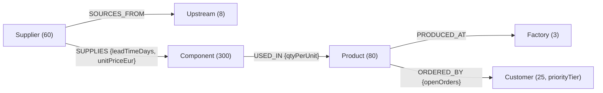

# Neo4j graph model

Multi-tier supply chain graph of SupplyGuard AI. Source: the CSV export in
[`src/support-data/graph/`](../src/support-data/graph/) and its reference load script `load.cypher`.
Seeded automatically by the `seed` service ([`scripts/seed.py`](../scripts/seed.py), `MERGE`, idempotent).



| Label | Key | Properties |
|---|---|---|
| `Supplier` | `supplierId` | `name`, `country`, `erpStatus`, `certificationExpiry` |
| `Upstream` | `upstreamId` | `name`, `country` |
| `Component` | `componentId` | `description` |
| `Product` | `productId` | `name` |
| `Factory` | `factoryId` | `name` |
| `Customer` | `customerId` | `name`, `priorityTier` |

| Relationship | Rows | Properties |
|---|---:|---|
| `(Supplier)-[:SUPPLIES]->(Component)` | 876 | `leadTimeDays`, `unitPriceEur` |
| `(Supplier)-[:SOURCES_FROM]->(Upstream)` | 59 | |
| `(Component)-[:USED_IN]->(Product)` | 616 | `qtyPerUnit` |
| `(Product)-[:PRODUCED_AT]->(Factory)` | 80 | |
| `(Product)-[:ORDERED_BY]->(Customer)` | 900 | `openOrders` |

**Provenance.** In the CSVs every node and relationship carries `sourceId` and `effectiveDate`, as the
brief requires. Generated claims must keep them.

**Deliberate data problems.** Suppliers S058–S060 and components MC-296…MC-300 are disconnected (see
`structured/data_quality_manifest.csv`).

## Queries used by the MC-17 case

Shared upstream (Atlas S001 and Delta S005 both source from Veltro, U01):

```cypher
MATCH (a:Supplier {supplierId:'S001'})-[:SOURCES_FROM]->(u)<-[:SOURCES_FROM]-(o:Supplier)
RETURN a.name, u.name, o.name
```

Alternative suppliers of a component, with lead time and price:

```cypher
MATCH (s:Supplier)-[x:SUPPLIES]->(:Component {componentId:'MC-17'})
RETURN s.supplierId, s.name, s.erpStatus, x.leadTimeDays, x.unitPriceEur ORDER BY x.leadTimeDays
```

Products, factories and customers exposed to a component:

```cypher
MATCH (:Component {componentId:'MC-17'})-[:USED_IN]->(p:Product)-[:PRODUCED_AT]->(f:Factory)
OPTIONAL MATCH (p)-[o:ORDERED_BY]->(k:Customer)
RETURN p.productId, f.name, k.name, k.priorityTier, o.openOrders
```

## Known gap in the seed

`scripts/seed.py` does not yet write `sourceId` and `effectiveDate` (on any node or relationship) or
`Supplier.certificationExpiry`. `load.cypher` does. Until the seed sets them, graph answers cannot cite
their source, and the certificate check (Borealis, expired 2026-09-30) cannot come from the graph.
→ Knowledge, Platform.
